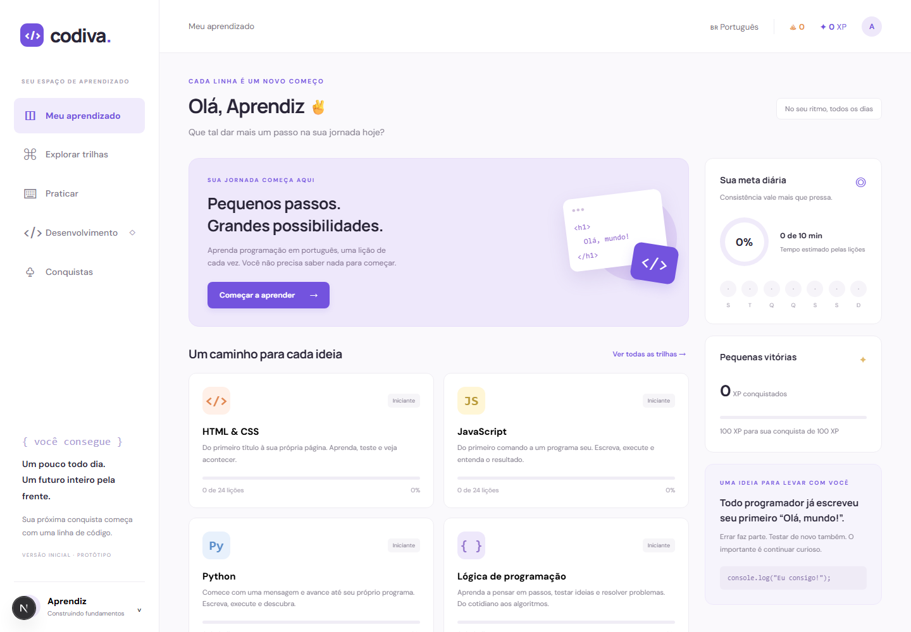
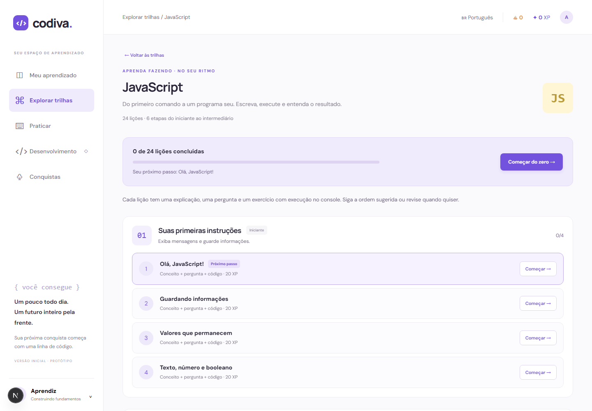
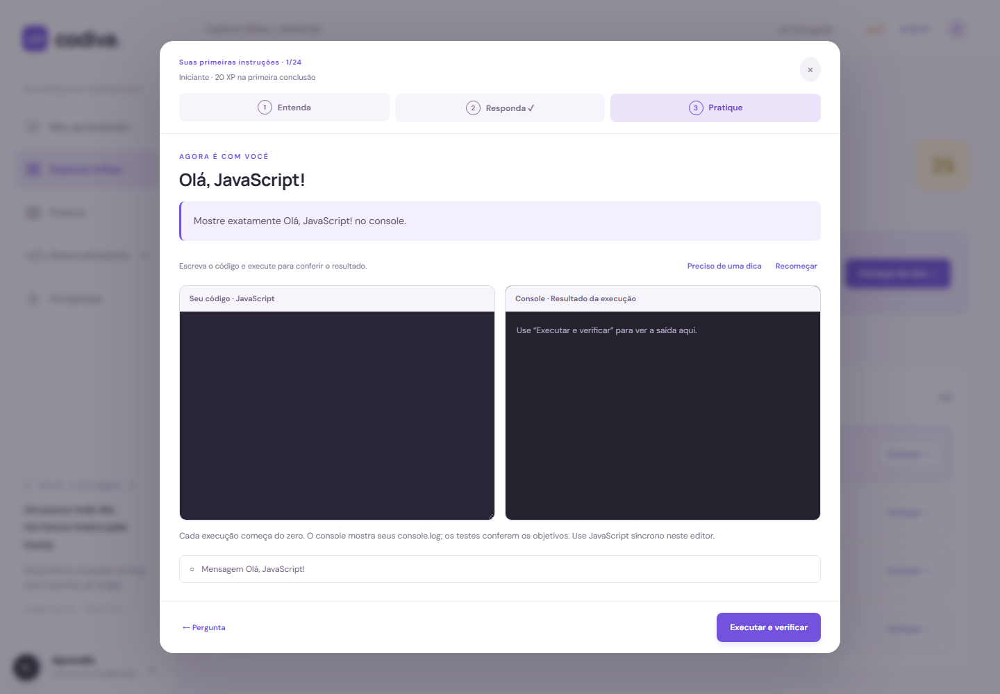

# Codiva — programação em português

Plataforma de estudos construída com Next.js 16, React 19 e App Router. A experiência combina explicação, pergunta e prática em **96 lições**: 24 de HTML & CSS, 24 de JavaScript, 24 de Python e 24 de lógica de programação.

[](https://nextjs.org/)
[](https://react.dev/)
[](#trilhas)
[](#como-funciona)

> Projeto educacional responsivo para aprender no próprio ritmo, praticar código no navegador e acompanhar a evolução sem depender de um serviço externo de execução.

## Visão da plataforma



O painel reúne progresso, meta diária, XP, conquistas e acesso às quatro trilhas. A navegação foi desenhada para funcionar em desktop e celular.



Cada trilha organiza as 24 lições em seis etapas progressivas, apresenta o próximo passo e mantém as referências complementares acessíveis.



Na prática, o estudante escreve código, executa no navegador, acompanha o console e recebe uma validação baseada nos objetivos da aula.

## Como funciona

1. **Escolha uma trilha:** HTML & CSS, JavaScript, Python ou lógica de programação.
2. **Entenda o conceito:** cada lição começa com uma explicação curta e um exemplo.
3. **Responda:** uma pergunta verifica a compreensão antes da prática.
4. **Pratique:** o exercício executa ou valida a solução e mostra os objetivos atendidos.
5. **Acompanhe o progresso:** conclusões, XP, sequência diária, rascunhos e meta ficam salvos no navegador.

## Trilhas

| Trilha | Experiência prática | Referências |
| --- | --- | --- |
| **HTML & CSS** | Editor com prévia isolada e validação via DOM/CSSOM. | [MDN — HTML](https://developer.mozilla.org/en-US/docs/Learn_web_development/Core/Structuring_content/Basic_HTML_syntax), [freeCodeCamp — Responsive Web Design](https://www.freecodecamp.org/news/freecodecamp-responsive-web-design-study-guide), [The Odin Project — HTML Boilerplate](https://www.theodinproject.com/lessons/foundations-html-boilerplate) |
| **JavaScript** | Execução descartável em Web Worker, console, limites de tempo e testes comportamentais. | [MDN — JavaScript](https://developer.mozilla.org/pt-BR/docs/Learn_web_development/Core/Scripting), [freeCodeCamp — JavaScript](https://www.freecodecamp.org/news/learn-javascript-for-beginners/), [The Odin Project — Variáveis e operadores](https://www.theodinproject.com/lessons/foundations-variables-and-operators) |
| **Python** | Python real no navegador com Pyodide/WebAssembly, console e verificação de resultados. | [Tutorial oficial do Python](https://docs.python.org/pt-br/3/tutorial/), [freeCodeCamp — Python Handbook](https://www.freecodecamp.org/news/the-python-handbook/), [Pyodide](https://pyodide.org/) |
| **Lógica** | Ordenação de passos, respostas numéricas, testes de mesa e cenários em pseudocódigo. | [CS50 — algoritmos e pseudocódigo](https://cs50.harvard.edu/x/2026/notes/0/), [Code.org — currículo de Ciência da Computação](https://code.org/cs/curriculum) |

## Destaques técnicos

- Aplicação responsiva exportada estaticamente pelo Next.js.
- JavaScript executado fora da interface em workers descartáveis, sem acesso ao DOM ou ao armazenamento.
- Python executado localmente com Pyodide; nenhum serviço externo recebe o código do estudante.
- Prévia HTML em iframe isolado, com scripts, rede e envios bloqueados.
- Progresso, rascunhos, XP e sequência diária persistidos no navegador.
- Exercícios cobertos por testes automatizados de progresso, JavaScript, Python e lógica.

Veja também o estudo de caso no [portfólio de Igor Silva](https://igorsilvadev01.github.io/Portfolio/#projetos).

## Rodar localmente

Requer Node.js 20.9 ou superior e npm. Execute os comandos na pasta `codiva`:

```sh
npm install
npm run dev
```

Abra http://localhost:3000.

## Verificar e gerar a versão de produção

```sh
npm test
npm run build
```

O build exporta o site estático para `out/`, conforme `output: "export"` em `next.config.mjs`. Essa pasta pode ser servida por um servidor HTTP estático. O projeto não usa `next start`, que exige uma implantação com servidor Next.js.

## Estrutura

- `app/layout.jsx`: documento, metadados e CSS global.
- `app/page.jsx`: entrada do App Router.
- `components/LearningApp.jsx`: componentes React do painel, catálogo, perfil, conquistas e lições.
- `components/CourseDetail.jsx`: módulos, progresso e indicação do próximo passo.
- `components/HtmlLessonDialog.jsx`: fluxo compartilhado de explicação, pergunta e prática para as quatro trilhas.
- `components/PracticeEditor.jsx`: editor, prévia HTML, console JavaScript/Python, indentação automática para Python e objetivos.
- `components/LogicPractice.jsx`: ordenação de passos com botões acessíveis, testes de mesa e cenários de lógica.
- `app/html-learning.css`: estilos responsivos da trilha e do editor.
- `app/js-learning.css`: painel de console e estados de execução.
- `app/logic-learning.css`: passos, campos de resposta e cenários responsivos.
- `lib/courses.mjs`: catálogo das quatro trilhas.
- `lib/html-course.mjs`: 24 lições de HTML & CSS, objetivos, dicas e referências.
- `lib/html-practice.mjs`: validação de objetivos com DOM/CSSOM e construção da prévia isolada.
- `lib/js-course.mjs`: 24 lições progressivas de JavaScript com testes de resultado.
- `lib/js-practice.mjs` e `public/js-runner-worker.js`: execução descartável em Web Worker, com cancelamento e limite de tempo.
- `lib/python-course.mjs`: 24 lições de Python, com seis módulos e projeto de resumo de gastos.
- `lib/python-practice.mjs`, `public/python-runner-worker.mjs` e `public/python-harness.mjs`: execução Python real via Pyodide, console e verificação de objetivos.
- `lib/logic-course.mjs` e `lib/logic-practice.mjs`: 24 lições de lógica, rascunhos estruturados e verificação das respostas.
- `scripts/prepare-python.mjs`: copia o interpretador instalado para `public/python-runtime/`, antes de iniciar o desenvolvimento ou gerar o build.
- `lib/progress.mjs`: validação, conclusão de lições, sequência diária e compatibilidade com o progresso anterior.
- `tests/progress.test.mjs`: testes de migração, XP, revisão e metas diárias.
- `tests/js-practice.test.mjs`: soluções das 24 aulas, erros de execução, testes de funções e compatibilidade de progresso.
- `tests/python-practice.test.mjs`: soluções das 24 aulas Python, tipos, indentação, isolamento de variáveis e compatibilidade de progresso.
- `tests/logic-practice.test.mjs`: soluções das 24 aulas de lógica, respostas numéricas, sequências, fronteiras, projeto final e progresso anterior.
- `.openai/hosting.json`: identidade do Site existente e diretório de publicação `out`.

## Comportamento

O progresso mantém a chave `codiva-progress` do protótipo anterior. O navegador recupera os dados depois da montagem dos componentes; não há acesso a `localStorage` durante a renderização no servidor. O primeiro acerto concluído concede 20 XP, e revisões não concedem XP adicional. A meta estima três minutos por lição nova. Nome e meta são editáveis também pelo menu móvel.

A trilha HTML & CSS tem seis módulos: primeiro contato, conteúdo, estrutura, navegação, formulários e projeto. Cada lição combina explicação, pergunta e exercício de código; a conclusão exige acertar a pergunta e cumprir os objetivos da prática. A verificação aceita diferentes estilos de aspas e formatação, mas avalia os requisitos específicos da aula; não é um validador completo do padrão HTML. Rascunhos são guardados por lição neste navegador. Os identificadores originais `html-0`, `html-1` e `html-2` continuam associados às suas lições, mesmo após a mudança de ordem.

A prévia usa um iframe sem permissões de sandbox e uma política de conteúdo que bloqueia scripts, requisições externas e envios. Links ficam desativados na prévia. Os formulários são exercícios de interface, sem backend de envio. As referências da MDN, freeCodeCamp e The Odin Project estão disponíveis no final da trilha.

A trilha JavaScript tem seis módulos: instruções, operações, decisões, listas e repetições, funções e projeto com objetos. Cada exercício executa JavaScript síncrono em um Web Worker separado da interface, mostra as mensagens do console e verifica resultados. Funções recebem testes com entradas diferentes. Os objetivos avaliam comportamento; não exigem uma única solução textual. O projeto final calcula minutos e dias para um plano de estudos. `js-0`, `js-1` e `js-2` preservam as conclusões antigas de variáveis, decisões e funções.

Cada execução tem limite de 1,5 segundo, 100 mensagens e 20.000 caracteres de código. Fechar a lição ou editar cancela uma execução pendente. O worker é encerrado depois de cada execução e não possui acesso ao DOM ou ao localStorage da página; as APIs de rede e armazenamento do executor são desativadas. Esta trilha ensina a linguagem no console, sem exercícios de DOM, requisições externas ou código assíncrono.

A trilha Python progride por primeiras instruções, textos, decisões, listas e repetições, funções e dicionários com projeto. Os exercícios usam Python real em WebAssembly com Pyodide 314.0.7, instalado pelo npm. O runtime (cerca de 13 MB) é servido pelo próprio site e incluído na exportação estática; nenhuma CDN ou serviço de execução externo é necessário. `npm install`/`npm ci`, `npm run dev` e `npm run build` preparam os arquivos automaticamente. `public/python-runtime/` é gerado e fica fora do Git.

Cada execução Python usa um worker descartável, com até 30 segundos para preparar o interpretador e 1,5 segundo para executar o código. Variáveis e arquivos temporários não passam para outra execução. Os exercícios usam apenas os recursos básicos da linguagem, sem `input()` ou importação de pacotes. Erros de sintaxe, nomes e indentação aparecem com a linha correspondente. As funções são verificadas com entradas diferentes; o console não inclui saídas das chamadas de teste. Rascunhos são salvos por lição, e os identificadores `py-0`, `py-1` e `py-2` mantêm as conclusões antigas de print, listas e for.

A trilha de lógica progride por algoritmos, variáveis e padrões, condições, decisões, repetições e resolução de problemas. Os exemplos usam pseudocódigo em português; a prática é estruturada, com ordenação de passos, respostas numéricas e seleção de resultados. Não há interpretador de pseudocódigo livre. A conclusão exige acertar a pergunta e todos os objetivos da atividade. O projeto final organiza um algoritmo de compra e verifica total, saldo e decisão em três cenários.

Os passos podem ser movidos com botões de subir/descer, também pelo teclado; alterações são anunciadas para leitores de tela. Campos numéricos aceitam negativos e vírgula ou ponto decimal, mas respostas vazias não contam como zero. Toda alteração invalida uma verificação anterior. Os rascunhos usam a mesma estrutura de salvamento das outras trilhas. `logic-0`, `logic-1` e `logic-2` preservam as conclusões antigas de algoritmo, verdadeiro/falso e padrões. As referências do CS50 e Code.org aparecem ao final da trilha.

## Próximas etapas

Adicionar uma trilha de JavaScript com DOM/eventos, contas e banco de dados, e preparar instalação como PWA ou aplicativo Android. A versão atual não inclui autenticação, sincronização, backend nem APK. Recursos de servidor exigirão rever a configuração de exportação estática.
